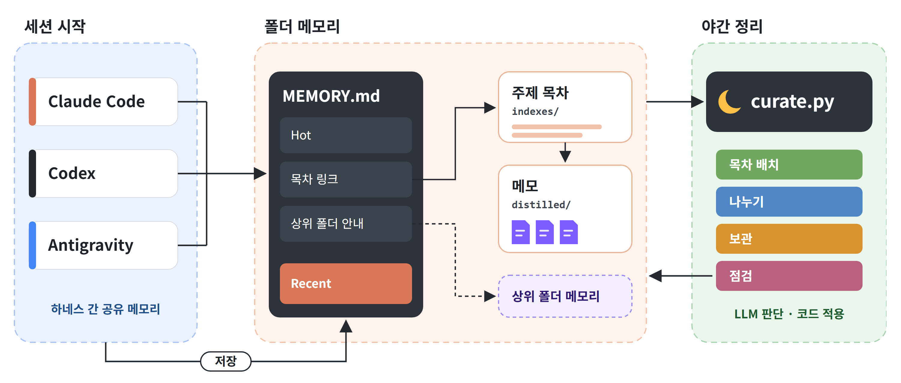

<div align="center">

# Harness Memory

**하네스 공용 LLM 메모리와 야간 정리**<br>
Claude Code · Codex · Antigravity

  

작업 폴더마다 메모리를 두고 세 하네스가 함께 읽고 쓰는 파일 기반 메모리<br>
세션 시작 시 짧은 목록만 읽고, 매일 밤 정리로 목차 분할과 진행 기록 보관을 수행

</div>

> 💡 AI 에이전트를 통한 설치: "github.com/ohh000410/Harness-Memory 의 AGENTS.md 를 읽고 설치해줘"

<br>

## 동작 구조

<p align="center">
  <picture>
    <source media="(prefers-color-scheme: dark)" srcset="assets/how-it-works-dark.png">
    
  </picture>
</p>

세션 시작 시 주입되는 것은 약 800토큰 이하의 목록 파일 하나이며, 나머지는 필요할 때 목차를 따라 연다. 정리에서 파일 수정은 **코드가 수행하고, LLM 은 판단만** 담당하여 메모를 넣을 목차, 서로 모순되는 메모, 큰 목차의 분할 방법을 JSON 으로 돌려준다.

<br>

## 개발 배경

claude-mem, Basic Memory 등 좋은 메모리 도구가 이미 있으나, 작성자 1인의 작업 환경에 맞는 도구가 없어 마크다운 메모와 `MEMORY.md` 로 이루어진 Claude Code 기본 메모리를 바탕으로 필요한 기능만 추가하였다.

- **세 하네스 공용 메모리** — Claude Code·Codex·Antigravity 를 번갈아 사용하므로, 하네스마다 메모리를 따로 두면 같은 사실이 세 곳에 나뉜다. 폴더마다 메모리 하나를 세 하네스가 함께 읽고 쓴다.
- **작업 폴더별 메모리** — 연구·생활 폴더가 수십 개이므로 폴더마다 메모리를 따로 두고, 하위 폴더는 상위 폴더 메모리를 함께 참조한다. 전역 메모리 하나로는 주제가 섞인다.
- **코드가 정리하고 LLM 은 판단만** — LLM 은 메모를 직접 고쳐 쓰지 않는다. 변경 전 백업과 변경 후 검증을 거치며, 완료된 진행 기록은 보관 폴더로 옮길 뿐 삭제하지 않는다.
- **추가 비용·상주 프로세스 없음** — 정리용 LLM 은 기존 Claude 구독의 `claude -p` 를 사용하며, 서버·DB·임베딩 API 가 필요 없다.
- **일반 마크다운** — 사람이 직접 읽고 고칠 수 있으며, 이 도구를 제거해도 메모는 그대로 남는다.

검색·지식 그래프가 중요하거나 여러 사람이 함께 사용하는 경우에는 기존 도구가 더 적합할 수 있다. 이 저장소는 한 사람이 폴더 단위로 오래 축적하는 메모리를 작고 정확하게 유지하는 데 목적을 둔다.

<br>

## 구성 파일

| 경로 | 기능 |
|---|---|
| `docs/memory-layout.md` | 메모리 형식 — 목록 → 주제 목차 → 메모 → 원본 기록의 4단 구조와 메모 머리말·링크·보관·소유권 규칙 |
| `templates/memory-rules.md` | CLAUDE.md·AGENTS.md·GEMINI.md 등 세션 지침에 추가하는 저장 규칙 |
| `hooks/ensure-memory-dir.ps1` | Claude Code 세션 시작 훅 — 처음 연 작업 폴더에 메모리를 생성하고 폴더 설정 `autoMemoryDirectory` 에 기록하며, Claude Code 가 그 `MEMORY.md` 를 자동으로 읽음. 하위 폴더는 상위 폴더 메모리를 함께 참조 |
| `hooks/inject-memory-index.ps1` | Codex 세션 시작 훅 — 위 훅을 먼저 실행해 메모리를 생성한 뒤, 해당 `MEMORY.md` 를 세션에 주입 |
| `hooks/agy-session-start.ps1` | Antigravity 훅 — 메인 대화의 첫 호출에서 위 Codex 훅을 실행하고 그 결과를 시스템 메시지로 주입하며, 서브에이전트 대화에는 주입하지 않음 |
| `skills/curate-memory/` | 정리 스킬 — 매일 밤 실행하는 `curate.py` 와, 요청 시 흩어진 지식을 메모 하나로 통합하는 `consolidate.py` |
| `scripts/register-nightly.ps1` | 작업 스케줄러에 매일 정리 등록 |
| `tests/` | LLM 없이 가상의 메모로 수행하는 시험 |

실제 메모 내용이나 작성자의 폴더 구조는 포함되어 있지 않으며, 예시는 모두 가상으로 작성하였다.

<br>

## 정리 기능

- **코드:** 변경된 메모리만 처리, 흩어진 메모의 재배치, 존재하지 않는 메모를 가리키는 줄 삭제, 머리말 보완, 끊긴 링크 정리, 취소선 문장을 날짜가 붙은 `superseded:` 표시로 변환, 8 KB 를 넘는 메모를 원문 그대로 분할한 뒤 이어 붙여 원본과 대조, log.md 회전, 변경 전 사본을 `raw/legacy/` 에 백업, 기록 후 재점검
- **LLM:** 도구 없이 `claude -p` 로 실행하며, 새 메모를 넣을 목차 결정, 메모가 15개에 이르면 주제 목차 3~7개로 묶기, 25줄을 넘는 목차의 주제별 분할, 서로 모순되는 메모 쌍 탐지, 길어진 목록 줄 축약
- **보관:** `type: project` 진행 기록 중 세션 메모리는 60일, 에이전트 메모리는 180일 이상 변경되지 않은 것을 `archive/` 로 이동한다. 규칙·참고·사용자 정보는 오래되어도 유지한다. 메모는 삭제하지 않으며, 변경하거나 통합한 원본은 `raw/legacy/` 에 남긴다.
- **보고:** 실행마다 발견 사항·수행 내용·미수행 내용·검증 결과·LLM 비용을 담은 보고서 작성

<br>

## 설치

1. 이 저장소를 내려받고 `config.example.json` 을 `config.json` 으로 복사한 뒤, 하위 폴더마다 메모리를 둘 작업 폴더를 `workspace` 에 지정한다. `roots` 를 지정하면 기본값과 합쳐지지 않으므로 정리할 위치를 모두 적는다.
2. 사용하는 하네스에 스킬을 연결한다. PowerShell 에서는 `cmd /c mklink /J <링크> <원본>` 으로 정션을 만들며, 상위 폴더가 없으면 먼저 생성한다. 링크로 연결하면 스크립트가 저장소의 `config.json` 을 찾는다. 복사한 경우에는 `setx MEMORY_CURATION_CONFIG C:\path\to\harness-memory\config.json` 을 실행한다.
   - Claude Code: `~/.claude/skills/curate-memory` → `<저장소>/skills/curate-memory`
   - Codex: `~/.agents/skills/curate-memory` → 같은 위치
   - Antigravity: `~/.gemini/config/skills.json` 에 저장소의 `skills` 폴더를 등록한다. 파일이 없으면 새로 만들고, 경로는 드라이브 문자와 `/` 로 적는다. agy 는 `~/.gemini/config/skills` 안의 정션은 건너뛰지만 이 목록의 경로는 바로 읽는다.

     ```json
     { "entries": [ { "path": "C:/path/to/harness-memory/skills" } ] }
     ```
3. 사용하는 하네스에 세션 시작 훅을 등록한다. 경로는 저장소 위치로 바꾼다.

   **Claude Code** — `~/.claude/settings.json`

   ```json
   {
     "env": { "CLAUDE_BASH_MAINTAIN_PROJECT_WORKING_DIR": "1" },
     "hooks": {
       "SessionStart": [
         { "matcher": "*", "hooks": [ { "type": "command",
           "command": "powershell -NoProfile -ExecutionPolicy Bypass -File \"C:\\path\\to\\harness-memory\\hooks\\ensure-memory-dir.ps1\"" } ] }
       ]
     }
   }
   ```

   `env` 설정은 명령마다 셸을 세션 폴더로 되돌린다. 이 설정이 없으면 하위 폴더로 `cd` 한 상태에서 대화를 `/compact` 로 압축할 때 훅이 그 하위 폴더를 받아 의도하지 않은 메모리가 생성된다.

   **Codex** — `~/.codex/hooks.json`, `CODEX_HOME` 을 사용하면 `$CODEX_HOME/hooks.json`. 훅 하나가 메모리 생성과 목록 주입을 모두 수행한다 — 두 훅으로 나누어 등록하면 Codex 가 동시에 시작하여 새 폴더의 첫 세션에서 목록이 누락된다. 등록 후 Codex 의 `/hooks` 에서 훅을 승인한다.

   ```json
   {
     "hooks": {
       "SessionStart": [
         { "matcher": "*", "hooks": [ { "type": "command", "timeout": 10,
           "command": "powershell -NoProfile -ExecutionPolicy Bypass -File \"C:\\path\\to\\harness-memory\\hooks\\inject-memory-index.ps1\"" } ] }
       ]
     }
   }
   ```

   **Antigravity** — agy 1.5.16 기준, `~/.gemini/config/hooks.json` 에 이름을 붙인 묶음 하나로 등록한다. 모델 호출마다 실행되지만 메인 대화의 첫 호출에서만 대화 내내 유지되는 시스템 메시지로 메모리 목록을 주입하며, 서브에이전트 대화에는 주입하지 않는다. agy 의 전역 `SessionStart` 는 서브에이전트 대화에서도 실행되어 둘을 구분할 수 없으므로 사용하지 않는다.

   ```json
   {
     "harness-memory": {
       "PreInvocation": [
         { "type": "command", "timeout": 30,
           "command": "powershell -NoProfile -ExecutionPolicy Bypass -File \"C:\\path\\to\\harness-memory\\hooks\\agy-session-start.ps1\"" }
       ]
     }
   }
   ```
4. [templates/memory-rules.md](templates/memory-rules.md) 를 사용하는 하네스의 지침 파일에 추가한다 — Claude Code `~/.claude/CLAUDE.md`, Codex `~/.codex/AGENTS.md`, Antigravity `~/.gemini/GEMINI.md`.
5. 매일 정리를 등록한다: `powershell -ExecutionPolicy Bypass -File scripts\register-nightly.ps1` 을 실행하며, 옵션은 `-At 04:30`, `-Python <경로>`, `-Remove` 이다. 로그온 중에 사용자 계정으로 실행되며, 실행 시 콘솔 창이 표시된다. `python`·`claude` 가 작업 스케줄러의 PATH 에서 실행 가능해야 한다.

에이전트 메모리 정리는 선택 사항이며, 설정 `roots.agent` 의 기본값은 Claude Code 의 에이전트 메모리 폴더 `~/.claude/agent-memory` 이다. 정리 방식은 세션 메모리와 같고 보관 기간만 180일이다. 서브에이전트를 사용하지 않으면 설정에서 `agent` 를 삭제한다.

<br>

## Subagents 연동

Inventor·Origin·SPEOS 등 Windows 앱을 다루는 같은 작성자의 [Subagents](https://github.com/ohh000410/Subagents) 는 수행 중 확인한 정보를 `~/.claude/agent-memory/<플러그인>-<에이전트>/` 에 기록한다. 메모 파일 하나와 `MEMORY.md` 말미의 링크 한 줄을 쓰는 Claude Code 기본 형식이므로 그대로 두면 줄이 계속 쌓인다. 이 저장소를 설치하고 `roots.agent` 를 기본값으로 두면 해당 폴더도 매일 밤 정리된다.

- 첫 정리: 메모 파일을 `distilled/` 로 옮기고, 링크 줄을 `## Leaves` 로, 메모가 15개 이상이면 주제 목차로 옮기며, 맨 끝에 `## Recent / pending curate` 칸을 둔다
- 이후: 에이전트가 `MEMORY.md` 끝에 덧붙인 줄은 Recent 칸에 들어가 다음 날 밤 제자리로 옮겨진다
- 에이전트 쪽 설정은 필요 없다 — Subagents 의 메모리 규칙이 "파일 하나 + 끝에 한 줄, 칸·목차는 수정하지 않음"이므로 정리와 충돌하지 않는다

<br>

## 사용법

```
python -X utf8 skills/curate-memory/scripts/curate.py --dry-run          # 변경 예정 사항만 보고서로 작성, 메모리·LLM 은 건드리지 않음
python -X utf8 skills/curate-memory/scripts/curate.py --only <메모리>     # 메모리 하나만 즉시 정리
python -X utf8 skills/curate-memory/scripts/consolidate.py propose --only <메모리>
```

- 세션에서 정리는 "curate memory", 재구성은 "consolidate memory" 로 요청하면 스킬이 위 명령을 실행한다 — [SKILL.md](skills/curate-memory/SKILL.md)
- 재구성은 미리보기만 생성하며, 사용자가 확인한 뒤 `apply` 해야 파일이 변경된다
- 시험: `python -X utf8 -m unittest discover tests` — 임시 폴더의 가상 메모로 LLM 없이 수행

<br>

## 요구 사항

- Windows — 훅과 스케줄러 등록에 PowerShell 을 사용한다. Python 스크립트는 운영체제와 무관하게 동작한다
- Python 3.10 이상, 추가 패키지 없음
- [Claude Code](https://docs.claude.com/en/docs/claude-code) CLI — 야간 정리의 LLM 판단을 `claude -p` 로 수행한다. Codex·Antigravity 만 사용하더라도 정리에는 필요하다. `--no-llm` 옵션을 쓰면 CLI 없이도 코드 수정은 수행된다

<br>

## 한계

- LLM 은 메모리를 하나씩만 검토하므로 메모리 간 중복은 찾지 못한다
- 폴더 이름에 `__` 를 사용하지 않는다 — 메모리 이름은 경로 구분자를 `__` 로 바꿔 만들어지므로 `a\b` 와 `a__b` 가 같은 이름이 된다
- 작성자의 Windows 11 PC 한 대에서 Codex 0.169, agy 1.5.16 으로 검증하였다. Codex·Antigravity 훅은 각 하네스의 훅 형식에 의존하므로, 형식이 바뀌면 다시 맞춰야 한다

<br>

## 라이선스

MIT 라이선스를 따르며, 전문은 `LICENSE` 에 있다.
