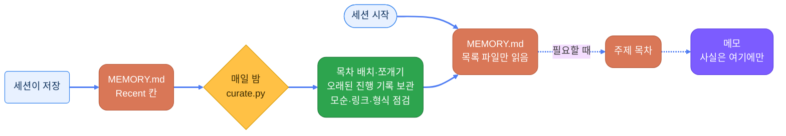

<div align="center">

# Harness Memory

**Claude Code·Codex·Antigravity 가 함께 쓰는 파일 메모리와 매일 밤 정리 스킬**

   

작업 폴더마다 메모리를 하나씩 두고, 어느 하네스로 열든 같은 메모리를 읽고 씁니다.<br>
세션은 짧은 목록 파일만 읽고 시작하고,<br>
메모가 쌓여도 매일 밤 정리 스크립트가 목차를 나누고 오래된 진행 기록을 치워 작게 유지합니다.

</div>

> 💡 AI 에이전트에게 설치를 맡기려면: "github.com/ohh000410/Harness-Memory 의 AGENTS.md 를 읽고 설치해줘"

<br>

## 이렇게 일합니다



세션 시작 때 들어가는 것은 약 800토큰 이하의 목록 파일 하나입니다. 나머지는 필요할 때 목차를 따라 엽니다. 정리는 **코드가 고치고, LLM 은 판단(JSON)만** 합니다 — 어느 목차에 넣을지, 무엇이 서로 모순되는지, 큰 목차를 어떻게 나눌지.

<br>

## 왜 직접 만들었나

이미 좋은 메모리 도구가 여럿 있지만(claude-mem, Basic Memory 등), 작성자 한 사람의 작업 환경에 딱 맞는 것이 없어 Claude Code 기본 메모리(마크다운 + `MEMORY.md`)에서 출발해 필요한 것만 붙였습니다.

- **세 하네스가 같은 메모리** — Claude Code·Codex·Antigravity 를 번갈아 쓰는데, 하네스마다 메모리를 따로 두면 같은 사실이 세 곳에 갈라집니다. 폴더마다 메모리 하나를 셋이 함께 읽고 씁니다.
- **작업 폴더마다 메모리** — 연구·생활 폴더가 수십 개라, 폴더마다 메모리를 따로 두고 하위 폴더는 상위 폴더 메모리를 함께 봅니다. 전역 메모리 하나로는 주제가 섞입니다.
- **정리는 코드가, LLM 은 판단만** — LLM 이 메모를 직접 고쳐 쓰지 않습니다. 바꾸기 전 백업, 바꾼 뒤 검증, 끝난 진행 기록만 보관으로 옮기고 지우지 않습니다.
- **추가 비용·상주 프로세스 없음** — 정리 LLM 은 쓰던 Claude 구독의 `claude -p`, 서버·DB·임베딩 API 가 없습니다.
- **그냥 마크다운** — 사람이 읽고 고칠 수 있고, 이 도구를 떼어 내도 메모는 그대로 남습니다.

검색·지식 그래프가 중요하거나 여러 사람이 함께 쓴다면 기존 도구가 더 맞을 수 있습니다. 이 저장소는 한 사람이 폴더 단위로 오래 쌓는 메모리를 작고 정확하게 유지하는 데 맞춰져 있습니다.

<br>

## 들어 있는 것

| 경로 | 하는 일 |
|---|---|
| `docs/memory-layout.md` | 메모리 형식 — 목록(L0) → 주제 목차(L1) → 메모(L2) → 원본 기록(raw), 메모 머리말·링크·보관·소유권 규칙 |
| `templates/memory-rules.md` | 세션 지침(CLAUDE.md·AGENTS.md·GEMINI.md)에 붙여 넣는 저장 규칙 |
| `hooks/ensure-memory-dir.ps1` | Claude Code 세션 시작 훅 — 처음 연 작업 폴더에 메모리를 만들고 폴더 설정 `autoMemoryDirectory` 에 기록(Claude Code 는 그 `MEMORY.md` 를 스스로 읽음). 하위 폴더는 상위 폴더 메모리를 함께 봄 |
| `hooks/inject-memory-index.ps1` | Codex 세션 시작 훅 — 위 훅을 먼저 돌려 메모리를 만들고, 그 `MEMORY.md` 를 세션에 넣음 |
| `hooks/agy-session-start.ps1` | Antigravity 훅 — 메인 대화의 첫 호출에서 위 Codex 훅을 돌려 그 결과를 시스템 메시지로 넣음(서브에이전트 대화에는 안 넣음) |
| `skills/curate-memory/` | 정리 스킬 — `curate.py`(매일 밤), `consolidate.py`(요청할 때 흩어진 지식을 메모 하나로 합침) |
| `scripts/register-nightly.ps1` | 작업 스케줄러에 매일 정리 등록 |
| `tests/` | 지어낸 가짜 메모로 하는 시험(LLM 없이) |

실제 메모 내용이나 작성자의 폴더 구조는 들어 있지 않습니다. 예시는 모두 지어낸 것입니다.

<br>

## 정리가 하는 일

- **코드:** 바뀐 메모리만 처리, 흩어진 메모를 제자리로, 없는 메모를 가리키는 줄 삭제, 머리말 채우기, 끊긴 링크 정리, 취소선 문장을 날짜 붙은 `superseded:` 표시로, 8 KB 넘는 메모를 원문 그대로 나눔(이어 붙이면 원본과 같은지 확인), log.md 회전, 바꾸기 전 사본을 `raw/legacy/` 에 백업, 쓴 뒤 다시 점검
- **LLM(`claude -p`, 도구 없음):** 새 메모를 넣을 목차, 메모가 15개가 되면 주제 목차 3~7개로 묶기, 목차가 25줄을 넘으면 주제별로 쪼개기, 서로 모순되는 메모 쌍, 길어진 목록 줄 줄이기
- **보관:** 60일(에이전트 메모리는 180일) 넘게 안 바뀐 진행 기록(`type: project`)은 `archive/` 로. 규칙·참고·사용자 정보는 오래돼도 남김. 메모를 지우지 않음 — 바꾸거나 합친 원본은 `raw/legacy/` 에 남김
- **보고:** 실행마다 보고서(찾은 것·한 것·못 한 것·검증·LLM 비용)

<br>

## 설치

1. 이 저장소를 받고 `config.example.json` 을 `config.json` 으로 복사해 `workspace`(하위 폴더마다 메모리를 둘 작업 폴더)를 적습니다. `roots` 를 적으면 기본값과 합쳐지지 않으니 정리할 위치를 모두 적습니다.
2. 쓰는 하네스에 스킬을 연결합니다(PowerShell 에서 정션은 `cmd /c mklink /J <링크> <원본>`, 상위 폴더가 없으면 먼저 만듦). 링크하면 스크립트가 저장소의 `config.json` 을 찾습니다. 복사했다면 `setx MEMORY_CURATION_CONFIG C:\path\to\harness-memory\config.json`.
   - Claude Code: `~/.claude/skills/curate-memory` → `<저장소>/skills/curate-memory`
   - Codex: `~/.agents/skills/curate-memory` → 같은 곳
   - Antigravity: `~/.gemini/config/skills.json` 에 저장소의 `skills` 폴더를 적음(없으면 새로 만듦, 경로는 `/` 와 드라이브 문자). agy 는 `~/.gemini/config/skills` 안의 정션은 건너뛰지만 이 목록의 경로는 바로 읽습니다.

     ```json
     { "entries": [ { "path": "C:/path/to/harness-memory/skills" } ] }
     ```
3. 쓰는 하네스에 세션 시작 훅을 넣습니다. 경로는 저장소 위치로 바꿉니다.

   **Claude Code** — `~/.claude/settings.json`

   ```json
   {
     "env": { "CLAUDE_BASH_MAINTAIN_PROJECT_WORKING_DIR": "1" },
     "hooks": {
       "SessionStart": [
         { "matcher": "*", "hooks": [ { "type": "command",
           "command": "powershell -NoProfile -ExecutionPolicy Bypass -File \"C:\\path\\to\\harness-memory\\hooks\\ensure-memory-dir.ps1\"" } ] }
       ]
     }
   }
   ```

   `env` 설정은 명령마다 셸을 세션 폴더로 되돌립니다. 없으면 하위 폴더로 `cd` 한 채 대화를 압축(/compact)할 때 훅이 그 하위 폴더를 받아 엉뚱한 메모리가 생깁니다.

   **Codex** — `~/.codex/hooks.json` (`CODEX_HOME` 을 쓰면 `$CODEX_HOME/hooks.json`). 훅 하나가 메모리를 만들고 그 목록을 넣습니다 — 둘로 나눠 등록하면 Codex 가 함께 시작해 새 폴더의 첫 세션에 목록이 빠집니다. 넣은 뒤 Codex 에서 `/hooks` 로 훅을 승인합니다.

   ```json
   {
     "hooks": {
       "SessionStart": [
         { "matcher": "*", "hooks": [ { "type": "command", "timeout": 10,
           "command": "powershell -NoProfile -ExecutionPolicy Bypass -File \"C:\\path\\to\\harness-memory\\hooks\\inject-memory-index.ps1\"" } ] }
       ]
     }
   }
   ```

   **Antigravity (agy 1.5.16)** — `~/.gemini/config/hooks.json` 에 이름 붙은 묶음 하나. 모델 호출마다 돌지만 메인 대화의 첫 호출에서만 메모리 목록을 넣고(대화 내내 남는 시스템 메시지), 서브에이전트 대화에는 넣지 않습니다. agy 의 `SessionStart` 는 서브에이전트 대화에서도 돌아 둘을 가를 수 없어서 쓰지 않습니다.

   ```json
   {
     "harness-memory": {
       "PreInvocation": [
         { "type": "command", "timeout": 30,
           "command": "powershell -NoProfile -ExecutionPolicy Bypass -File \"C:\\path\\to\\harness-memory\\hooks\\agy-session-start.ps1\"" }
       ]
     }
   }
   ```
4. [templates/memory-rules.md](templates/memory-rules.md) 를 쓰는 하네스의 지침 파일에 붙여 넣습니다 — Claude Code `~/.claude/CLAUDE.md`, Codex `~/.codex/AGENTS.md`, Antigravity `~/.gemini/GEMINI.md`.
5. 매일 정리를 등록합니다: `powershell -ExecutionPolicy Bypass -File scripts\register-nightly.ps1` (`-At 04:30`, `-Python <경로>`, `-Remove`). 로그온한 동안 내 계정으로 돌고, 실행 때 콘솔 창이 뜹니다. `python`·`claude` 가 작업 스케줄러의 PATH 에서 보여야 합니다.

에이전트 메모리(`roots.agent`, 기본값은 Claude Code 의 에이전트 메모리 폴더 `~/.claude/agent-memory`)는 선택입니다. 정리는 세션 메모리와 같고 보관 기간만 180일입니다. 서브에이전트를 쓰지 않으면 설정에서 `agent` 를 지웁니다.

<br>

## Subagents 와 같이 쓰기

같은 작성자의 [Subagents](https://github.com/ohh000410/Subagents)(Inventor·Origin·SPEOS 등 Windows 앱을 다루는 서브에이전트)는 쓰면서 배운 것을 `~/.claude/agent-memory/<플러그인>-<에이전트>/` 에 기록합니다. Claude Code 기본 형식(메모 파일 하나 + `MEMORY.md` 끝에 링크 한 줄)이라 그대로 두면 한 줄씩 쌓이기만 합니다. 이 저장소를 설치하고 `roots.agent` 를 기본값 그대로 두면 그 폴더들도 매일 밤 정리됩니다.

- 첫 정리: 메모 파일을 `distilled/` 로 옮기고, 링크 줄을 `## Leaves`(메모 15개부터는 주제 목차)로 옮기고, 맨 끝에 `## Recent / pending curate` 칸을 둡니다
- 그 뒤: 에이전트가 `MEMORY.md` 끝에 덧붙인 줄은 Recent 칸에 들어가 다음 날 밤 제자리로 갑니다
- 에이전트 쪽 설정은 없습니다 — Subagents 의 메모리 규칙이 "파일 하나 + 끝에 한 줄, 칸·목차는 고치지 않음"이라 정리와 겹치지 않습니다

<br>

## 쓰는 방식

```
python -X utf8 skills/curate-memory/scripts/curate.py --dry-run          # 바꿀 것만 보고(메모리·LLM 안 건드림, 보고서만 씀)
python -X utf8 skills/curate-memory/scripts/curate.py --only <메모리>     # 하나만 지금
python -X utf8 skills/curate-memory/scripts/consolidate.py propose --only <메모리>
```

- 세션에서는 "curate memory"(정리) / "consolidate memory"(재구성)라고 하면 스킬이 위 명령을 씁니다 — [SKILL.md](skills/curate-memory/SKILL.md)
- 재구성은 미리보기만 만들고, 사용자가 확인한 뒤 `apply` 해야 파일이 바뀝니다
- 시험: `python -X utf8 -m unittest discover tests` (임시 폴더의 가짜 메모, LLM 없음)

<br>

## 필요한 것

- Windows — 훅과 스케줄러 등록이 PowerShell 입니다(Python 스크립트는 어디서나 돕니다)
- Python 3.10+ (추가 패키지 없음)
- [Claude Code](https://docs.claude.com/en/docs/claude-code) CLI — 밤 정리의 LLM 판단(`claude -p`)용. Codex·Antigravity 만 쓰더라도 정리에는 필요합니다. `--no-llm` 이면 없어도 코드 고치기는 됩니다

<br>

## 한계

- LLM 은 메모리 하나씩만 봅니다 — 메모리 사이의 중복은 못 찾습니다
- 폴더 이름에 `__` 를 쓰지 마세요 — 메모리 이름이 경로 구분을 `__` 로 바꿔 만들어져 `a\b` 와 `a__b` 가 같은 이름이 됩니다
- 작성자의 Windows 11 PC 한 대에서 확인했습니다(Codex 0.169, agy 1.5.16). Codex·Antigravity 훅은 각 하네스의 훅 형식에 기대므로, 형식이 바뀌면 다시 맞춰야 합니다

<br>

## 라이선스

MIT (`LICENSE`).
